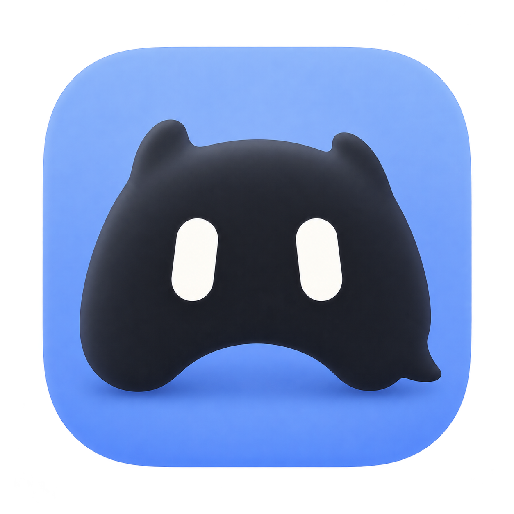
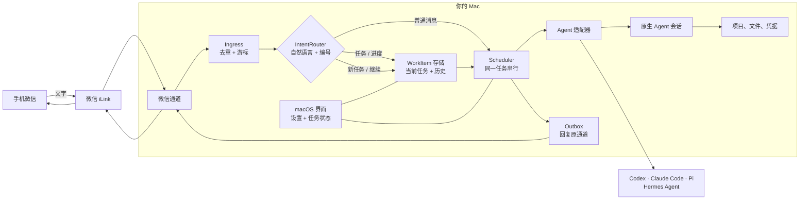
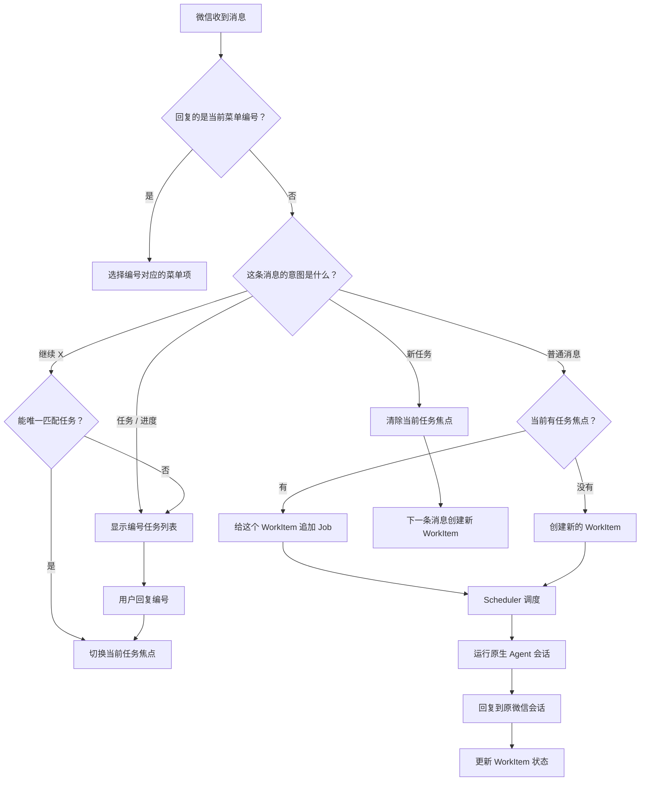

<div align="center">
  
  <h1>Chat Bridge</h1>
  <p>把电脑上的 AI 会话，带进微信。</p>
  <p><a href="README.md">English</a> · <strong>中文</strong> · <a href="README.ja.md">日本語</a> · <a href="README.ko.md">한국어</a> · <a href="README.fr.md">Français</a> · <a href="README.es.md">Español</a></p>


[](https://github.com/section9-lab/chat-bridge/releases)
[](LICENSE)

</div>

## 看它如何工作

<p align="center"></p>
<p align="center"><a href="docs/assets/chat-bridge-intro.mp4">高清 MP4 · 可暂停查看</a> · <a href="docs/assets/chat-bridge-intro-poster.png">静态预览</a></p>
<p align="center"><sub>应用首次启动时的 54 秒引导动画，直接录制原生 SwiftUI 界面；任务和回复为演示数据，不连接真实账号。</sub></p>

## 离开电脑，也能接着聊

Chat Bridge 是一款 macOS 菜单栏应用。把微信连接到 Mac 上的 AI Agent，就能从手机发起任务、继续已有会话，让结果回到原来的聊天里。

- **接着聊**：继续电脑上的已有会话，保留项目和上下文。
- **直接说意图**：新建会话、选择项目、切换 Agent，用一句话完成。
- **拿到结果**：接收回复，以及任务产出的图片、视频和文档。
- **随手打开**：菜单栏只留一个 Logo，点击恢复上次会话和草稿。

## 架构



消息保存在你的 Mac 上，交给当前任务对应的原生 Agent 会话。切换任务只改变 WorkItem 焦点，不会改变正在运行的会话。完整状态模型见 [微信单通道 Super Agent 方案](docs/wechat-only-super-agent-plan.md)。

## 任务流程



## 你可以这样说

> 用 Codex 继续「旅行清单」项目，帮我整理周末计划。

> 用 Claude 新建一个无项目会话，给我三个早餐点子。

> 列出 Claude 在「商城」项目里的会话。

普通消息默认继续当前任务。回复“任务”或“进度”查看任务列表，回复编号切换；回复“新任务”开始独立任务。每次接收任务，都会告诉你消息发到了哪里：

```text
Codex > 旅行清单 > 周末计划
已收到✅
```

## 三步开始

在 [Releases](https://github.com/section9-lab/chat-bridge/releases) 选择 DMG：Apple Silicon 使用 **arm64**，Intel 使用 **x86_64**。打开后将 **Chat Bridge** 拖入 **Applications**。如果尚无可用版本，可按下方说明从源码构建。

DMG 使用 ad-hoc 签名，未经 Apple 公证。首次打开若被阻止，请先确认下载来源，再在「系统设置 → 隐私与安全性」中对该应用选择「仍要打开」。应用启动后和每小时会检查 GitHub Releases；也可以在设置或菜单栏手动检查更新。

<details>
<summary>从源码运行</summary>

需要 Xcode Command Line Tools、Python 3 和网络连接。在仓库根目录执行：

```sh
bash scripts/build-app.sh
open "dist/Chat Bridge.app"
```

默认使用 Apple Development 证书签名。没有证书时，在构建命令前加 `CHAT_BRIDGE_SIGNING_IDENTITY=-`；这种本地签名构建未经过 Apple 公证。

</details>

1. **连接 Agent** — 在 Mac 上安装并登录常用 Agent，在 Chat Bridge 里检查连接状态。
2. **配对消息通道** — 打开「设置 → 消息通道」，用微信扫码。
3. **发出第一条消息** — 从微信说出你想做的事，也可直接在菜单栏浮窗中聊天。普通消息继续当前任务；回复“任务”切换，回复“新任务”开始新的。

## 与你常用的 Agent 一起工作

**Codex · Claude Code · Pi · Hermes Agent**

沿用各 Agent 的本机登录和模型配置。可以新建项目内会话、直接开启无项目会话，也能恢复已有会话。实际可用性取决于安装、登录、模型服务和各运行时能力；Claude Chat 与 Cowork 暂未接入。

## 使用前了解

- 需要 **macOS 13.5+**，并保持 Mac 开机、联网和 Chat Bridge 运行。
- 桌面输入框输入 **@文件名** 即可搜索并从候选列表添加文件，左侧回形针也可进入搜索（每条最多 10 个，每个不超过 50 MiB），回复会引用原始消息。微信仍仅支持**文字输入**，收到的语音、图片和附件不会作为任务执行；符合要求的成果文件可发送回原通道。
- 连接后，消息可以触发文件修改、命令和网络访问。Bridge 创建或恢复的 Codex／Claude Code 会话默认允许完整执行权限，请只绑定自己的可信账号。
- 会话状态保存在 Mac 本地；消息经微信和所选 Agent 服务处理，不经过额外的路由服务。
- 遇到发送结果不确定的情况，不会自动重复执行或重发。应用界面目前以中文为主。

## 更多

[反馈问题](https://github.com/section9-lab/chat-bridge/issues) · [MIT 许可证](LICENSE)
