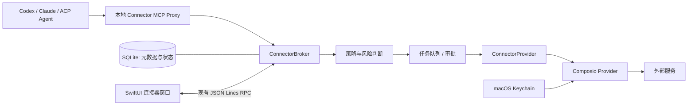

# Chat Bridge 连接器设计方案

版本：0.1（提案）  
日期：2026-11-03  
状态：已确认；阶段 A（目录、账号连接、权限策略与原生界面）已实施，Agent 工具执行阶段待继续验收

## 1. 目标

为 Chat Bridge 增加独立于“Agent”和“消息通道”的**连接器**能力，让 Agent 在获得用户明确授权后访问 GitHub、邮箱、日历、知识库、协作工具等外部服务。

首个连接器提供方采用 Composio，但内部必须保留提供方抽象，避免界面、权限和 Agent 运行时直接依赖 Composio。未来可以接入本地 MCP、自定义企业连接器或其他托管服务。

### 1.1 产品原则

1. **连接不等于授权执行**：连接账号后，仍需选择哪些 Agent 可以访问，以及写入操作是否需要确认。
2. **默认最小权限**：默认允许读取；创建、发送、修改和删除默认需要单次确认；高风险操作始终确认。
3. **本地策略优先**：Agent 不直接持有 Composio API Key、OAuth token 或直连 MCP 地址。所有工具调用必须经过 Chat Bridge 本地策略层。
4. **动态目录**：连接器和工具从提供方目录读取，不在 Swift 或 Agent 适配器中逐个硬编码。
5. **结果不确定时不重试**：工具调用超时或断线后标记为“结果待确认”，不得自动重复执行。
6. **诚实展示能力**：只有通过运行时验证、策略检查和真实调用验收的 Agent 才显示“可使用连接器”。

### 1.2 非目标

首版不做：

- 第三方插件代码在 Chat Bridge 主进程中任意运行。
- 将用户 OAuth token、API Key 或完整工具参数写入 SQLite、日志或消息通道。
- 未经确认的付款、权限管理、批量删除、公开发布等高风险操作。
- 让消息通道直接调用连接器并绕过 Agent、任务队列和审批流程。
- 在应用包中内置 Chat Bridge 自己的 Composio 项目密钥。

## 2. 概念模型

| 名称 | 含义 |
| --- | --- |
| 连接器定义 `ConnectorDefinition` | 一个外部服务的目录项，例如 GitHub、日历或知识库。对应 Composio Toolkit，但不等于已连接账号。 |
| 认证配置 `AuthConfiguration` | OAuth、API Key、Bearer、Basic 等认证方式及权限范围。对应 Composio Auth Config。 |
| 已连接账号 `ConnectedAccount` | 用户完成认证后的具体账号。一个连接器可有多个账号。 |
| 工具 `ConnectorTool` | 连接器提供的可执行动作，例如搜索、创建、发送或更新。 |
| 访问策略 `ConnectorPolicy` | 哪些 Agent 可以访问、允许哪些工具、写入操作是否审批。 |
| 调用记录 `ConnectorInvocation` | 一次工具调用的本地状态、风险、审批和结果摘要。 |

“消息通道”负责从微信或 iMessage 收发消息；“连接器”负责让 Agent 操作外部服务。两者在界面和数据模型中不得混用。

## 3. 推荐的信息架构

连接器数量可能很多，不应塞进现有设置页的一段长列表。新增独立的原生窗口 **“连接器”**，设置页只提供入口和服务状态。

### 3.1 连接器窗口

使用 `NavigationSplitView`、`List`、`Form`、系统工具栏和系统搜索框：

```text
┌──────────────────────────────────────────────────────────────────────┐
│ 连接器                         [搜索连接器]      [刷新]              │
├──────────────┬────────────────────────┬───────────────────────────────┤
│ 全部         │ GitHub                 │ GitHub                        │
│ 已连接       │ Google Calendar        │ 状态：已连接                  │
│ 需要处理  1  │ Notion                 │ 账号：work@example.com        │
│              │ Slack                  │                               │
│ 开发         │ …                      │ 可用于                         │
│ 沟通         │                        │ ☑ Codex  ☑ Claude  ☐ Cursor  │
│ 效率         │                        │                               │
│ 数据         │                        │ 操作策略                       │
│              │                        │ [读取] [更改前询问]            │
│              │                        │                               │
│              │                        │ [断开连接…]                    │
└──────────────┴────────────────────────┴───────────────────────────────┘
```

#### 侧栏

- “全部”“已连接”“需要处理”。
- 提供方返回的稳定分类；未知分类进入“其他”。
- 恢复上次选择。
- 侧栏搜索仅用于导航过滤，支持 `⌘F`。

#### 内容列表

每行只展示：

- SF Symbol 分类图标，不下载或混用第三方品牌图标。
- 连接器名称和一句用途说明。
- 状态：未连接、连接中、已连接、需要重新认证、不可用。
- 多账号时显示账号数量。

不要使用大面积彩色卡片、渐变或每个服务不同的按钮风格。

#### 详情区

- 账号和认证状态。
- 当前授权范围及“重新授权”。
- 可访问此账号的 Agent。
- 操作策略和危险操作说明。
- 最近使用时间；不展示敏感参数。
- 连接、重新连接和断开操作。

### 3.2 对话中的入口

在主看板对话标题栏加入一个安静的 `link` SF Symbol 按钮：

- 徽标显示当前 Agent 可用的已连接账号数量。
- 点击打开 `popover`，只列当前 Agent 可用的账号和状态。
- 底部提供“管理连接器…”打开完整窗口。
- 菜单栏浮窗不常驻展示连接器列表，避免挤压会话；仅在工具调用审批卡中显示相关连接器。

### 3.3 设置入口

在“通用”或独立的原生设置工具栏项目中显示：

- 连接器服务：未配置／已连接／需要检查。
- “管理连接器…”按钮。
- Composio API Key 的配置与移除入口。

长期应将当前自定义分段设置导航迁移为 macOS 标准、不可自定义的设置工具栏，并记住上次打开的设置面板。

## 4. 关键用户流程

### 4.1 首次启用 Composio

1. 用户打开“连接器”。
2. 空状态说明：连接器会让 Agent 访问外部服务；敏感操作仍由 Chat Bridge 审批。
3. 用户选择“设置 Composio”。
4. 在安全表单中粘贴自己的 Composio API Key。
5. Key 通过原生 Keychain 保存，Node 服务只在请求期间读取到内存。
6. 应用执行一次只读验证并加载目录。
7. 验证成功后进入连接器目录；失败时保留输入窗口，不清空用户刚输入的 Key，提供可复制的错误说明。

当前 Chat Bridge 是本地应用且没有云端账户系统，因此首版推荐 **BYOK**。绝不能把共享 Composio 项目密钥打包进应用。未来若增加 Chat Bridge 云服务，应改为服务端保管项目密钥，并向本机签发短期、受限令牌。

### 4.2 连接账号

1. 用户选中连接器并点击“连接账号…”。
2. 应用先展示认证方式、权限范围、数据接收方和将允许访问的 Agent。
3. Node 服务向提供方创建连接链接，返回短时 `redirectURL`、`attemptID` 和过期时间。
4. Swift 使用 `ASWebAuthenticationSession` 打开系统认证流程，而不是嵌入自定义 WebView。
5. 回调应用后，Node 查询账号状态；只有提供方确认 `ACTIVE` 才显示“已连接”。
6. 用户选择允许访问的 Agent。默认不启用所有 Agent；完成前至少明确选择一个。
7. 默认策略为“读取直接允许，更改前询问”。

如果认证需要 API Key，优先让托管连接页收集，避免 Chat Bridge 接触外部服务密钥。确需本机输入时，字段使用安全输入控件，提交后立即清除，不写入本地数据库。

### 4.3 Agent 使用工具

1. Agent 搜索可用工具。
2. 本地 `ConnectorBroker` 根据 Agent、会话、账号和策略过滤工具。
3. Agent 请求执行具体工具。
4. Broker 校验参数结构并进行风险分类。
5. 只读低风险操作直接进入任务队列。
6. 写入或高风险操作创建原生审批卡；未批准前不向外部服务提交。
7. 执行完成后，只把经过大小限制和敏感字段清理的结果返回 Agent。
8. Agent 形成正常回复，经原任务来源通道返回。

### 4.4 审批卡

审批卡复用现有 `ApprovalCard`，增加连接器类型，显示：

- 连接器和账号标签。
- 将执行的动作，例如“在 GitHub 创建 Issue”。
- 对用户可读的目标和关键字段摘要。
- 风险等级和原因。
- “允许一次”“拒绝”按钮。

默认不提供“始终允许”快捷按钮。批量删除、付款、权限变更、发送公开内容等操作即使策略为允许写入，也必须单次确认。

### 4.5 断开账号

- 使用系统确认对话框，按钮文案为“断开连接”，采用 destructive role。
- 明确说明这是停止 Chat Bridge 使用该账号，还是同时撤销提供方授权。
- 断开后立即使本地策略失效，正在排队但尚未提交的调用全部取消。
- 已经提交、状态不确定的调用不能伪装成已取消。

## 5. 系统架构



### 5.1 为什么需要本地代理

不能把 Composio 的直连 MCP URL 或项目密钥直接交给 Agent。否则工具调用可能绕过 Chat Bridge 的：

- Agent 与账号访问策略。
- 单次审批。
- 任务排队和停止状态。
- 不确定结果保护。
- 本地审计与敏感数据清理。

Agent 只连接 Chat Bridge 创建的本地、会话级工具代理。首选 `stdio`，不监听端口。若某运行时只能使用 Streamable HTTP，必须仅绑定 `127.0.0.1`，使用每会话随机 bearer token，并在会话结束后立即关闭。

### 5.2 提供方接口

```ts
interface ConnectorProvider {
  probe(): Promise<ConnectorProviderStatus>;
  listConnectors(cursor?: string): Promise<ConnectorPage>;
  createConnectLink(input: ConnectLinkInput): Promise<ConnectLink>;
  getAccount(accountId: string): Promise<ConnectedAccount>;
  disconnectAccount(accountId: string): Promise<void>;
  searchTools(input: ToolSearchInput): Promise<ConnectorTool[]>;
  getToolSchema(toolId: string): Promise<ConnectorToolSchema>;
  execute(input: ToolExecutionInput): Promise<ToolExecutionResult>;
}
```

Composio 术语只存在于 `ComposioConnectorProvider` 内部；Swift UI、SQLite 状态和 Agent 工具名称使用 Chat Bridge 的中立模型。

### 5.3 Agent 工具面

不要向每个 Agent 一次注入数百个工具。提供三个稳定的元工具：

1. `chat_bridge_search_connector_tools`
2. `chat_bridge_get_connector_tool`
3. `chat_bridge_execute_connector_tool`

搜索结果仅包含当前 Agent 和当前会话可用的连接器。`execute` 中的 `toolID` 和参数必须再次经过本地校验，不能信任模型先前看到的搜索结果。

AgentAdapter 增加显式能力：

```ts
type AgentConnectorCapabilities = {
  canAttachConnectorTools: boolean;
  transport?: "stdio" | "streamable-http";
};
```

未通过真实运行时验证的 Agent 不注入工具，并在 UI 中解释原因。首轮建议只验收 Codex 与 Claude Code，再扩展到其他 ACP Agent。

## 6. 本地数据模型

SQLite 只保存非秘密数据：

```ts
type ConnectorDefinition = {
  id: string;
  provider: string;
  remoteId: string;
  name: string;
  description: string;
  category: string;
  authSchemes: string[];
  cachedAt: string;
};

type ConnectedAccount = {
  id: string;
  provider: string;
  connectorId: string;
  remoteAccountId: string;
  label?: string;
  status: "connecting" | "active" | "expired" | "revoked" | "error";
  createdAt: string;
  lastUsedAt?: string;
};

type ConnectorPolicy = {
  accountId: string;
  allowedAgents: string[];
  mode: "read-only" | "confirm-writes" | "allow-writes";
  allowedTools?: string[];
  deniedTools?: string[];
};

type ConnectorInvocation = {
  id: string;
  jobId: string;
  agent: string;
  sessionId: string;
  accountId: string;
  toolId: string;
  summary: string;
  risk: "read" | "write" | "destructive" | "financial" | "permission";
  status: "pending" | "awaiting_approval" | "running" | "completed" | "failed" | "uncertain" | "cancelled";
  createdAt: string;
  completedAt?: string;
};
```

禁止保存：

- Composio API Key 明文。
- OAuth access/refresh token。
- 外部服务 API Key。
- 工具调用的完整原始参数和完整响应。
- 可能包含消息正文、邮件正文或个人数据的调试日志。

连接器目录可缓存 24 小时。离线时可以浏览缓存，但不能连接、重新认证或执行工具。

## 7. RPC 设计

沿用现有 JSON Lines RPC 和显式 allowlist。

### 7.1 Swift → Node

| 方法 | 用途 |
| --- | --- |
| `connector.provider.get` | 读取提供方配置和验证状态。 |
| `connector.provider.key.save` | 保存并验证 Composio API Key。 |
| `connector.provider.key.remove` | 从 Keychain 移除 Key，并停用连接器。 |
| `connector.catalog.list` | 搜索、筛选和分页读取目录。 |
| `connector.account.link` | 创建短时认证链接。 |
| `connector.account.complete` | Web 认证返回后确认状态。 |
| `connector.account.disconnect` | 断开账号。 |
| `connector.policy.update` | 更新 Agent 和工具策略。 |
| `connector.invocations.list` | 读取经过清理的最近调用记录。 |

### 7.2 Node → Swift

| 方法 | 用途 |
| --- | --- |
| `native.composio.credential.read/write/remove` | Keychain 操作。 |

Web 认证不应占用一个长时间 RPC 请求。`connector.account.link` 返回 URL 后立即结束；Swift 完成 `ASWebAuthenticationSession` 再调用 `connector.account.complete`。

### 7.3 状态快照

`BridgeState` 增加轻量摘要，不把完整目录塞入每次 `state.changed`：

```ts
type ConnectorStateSummary = {
  provider: { configured: boolean; status: string; message?: string };
  connectedCount: number;
  attentionCount: number;
  availableByAgent: Record<string, number>;
  activeInvocations: ConnectorInvocationSummary[];
};
```

目录、详情和历史通过独立分页 RPC 获取，避免超过现有 1 MiB IPC 限制。

## 8. 风险分类和审批规则

| 风险 | 示例 | 默认行为 |
| --- | --- | --- |
| `read` | 搜索、读取、列出 | 已授权 Agent 可直接执行。 |
| `write` | 创建草稿、更新记录 | 默认单次确认。用户可对特定账号改为允许。 |
| `destructive` | 删除、归档、覆盖 | 始终单次确认。 |
| `financial` | 下单、付款、退款 | 始终单次确认；首版可整体禁用。 |
| `permission` | 邀请成员、修改权限、创建令牌 | 始终单次确认。 |

风险分类来源顺序：

1. Chat Bridge 本地高风险规则。
2. 提供方工具元数据。
3. 对未知工具保守降级为 `write`，不得降级成 `read`。

执行前必须再次检查账号仍为 active、策略版本未变化、审批未过期、任务目标未改变。

## 9. 安全与隐私

1. **Keychain**：Composio API Key 使用独立 account，例如 `composio-v1`，访问方法加入原生 allowlist。
2. **稳定用户标识**：为本机生成随机 `connectorUserID`，例如 `cb_<uuid>`；不使用姓名、邮箱、Apple ID 或硬件序列号。
3. **最小暴露**：Agent 只看到工具需要的结果；认证信息永不进入 prompt。
4. **参数清理**：审批摘要使用白名单字段；密码、token、cookie、Authorization 等字段一律遮盖。
5. **输出限制**：单次工具结果设置字节上限和分页游标；二进制结果进入受控附件目录，不穿过 JSON Lines 传整份数据。
6. **幂等与未知结果**：只有提供方明确支持且操作语义安全时才使用幂等键；超时不自动重发。
7. **撤销优先**：账号过期、撤销或策略关闭时立即阻止新调用。
8. **本地日志**：只记录调用 ID、工具 ID、状态、耗时和错误类别，不记录正文和凭据。
9. **远程审批**：发送到微信或 iMessage 的审批摘要不得包含邮件正文、私密文档内容或完整参数。

## 10. macOS HIG 约束

- 使用系统 `NavigationSplitView`、`List`、`Form`、`ToolbarItem`、`searchable`、`alert` 和 `confirmationDialog`。
- 使用系统字体层级和系统颜色；支持浅色、深色、高对比度、减少透明度和减少动态效果。
- 仅使用 SF Symbols 表达类别和状态，不为每个连接器手绘图标或混用图标库。
- 搜索位于工具栏尾部或侧栏顶部；刷新、添加和更多操作使用标准位置。
- 工具栏中的主要命令同时出现在 macOS 菜单栏。
- 可恢复错误使用详情区内联提示，不频繁弹出阻断式警告。
- 仅在用户点击“连接账号”时请求认证，不在启动时自动打开网页或请求权限。
- 所有状态图标同时提供文字，不只依赖颜色。
- 所有按钮、开关、账号行、审批卡提供 VoiceOver 标签、帮助文本和清晰焦点顺序。
- `Esc` 取消当前表单或认证；`⌘F` 聚焦搜索；列表支持方向键导航；默认按钮只用于安全、明确的下一步。
- 连接器窗口建议最小尺寸 `820 × 600`，但布局必须在更窄宽度下保持可用，不使用固定三栏魔法宽度。

参考：Apple HIG 的 Settings、Toolbars、Search Fields、Lists and Tables、Privacy 指南。

## 11. 完整状态

每个界面必须覆盖：

- **Loading**：目录、账号状态或工具正在加载，使用系统 `ProgressView`。
- **Empty**：未配置提供方、未连接账号、筛选无结果分别使用不同文案。
- **Error**：Key 无效、网络失败、认证取消、账号过期、权限不足、限流。
- **Offline**：显示缓存目录和上次更新时间；禁用需要网络的操作。
- **Disabled**：说明是 Agent 不支持工具、策略未授权，还是账号不可用。
- **Hover / Focus / Selected**：使用系统 List 行为和强调色。
- **Unknown result**：明确提示“操作可能已经执行，请在原服务核对；Chat Bridge 未自动重试”。

推荐状态文案：

| 状态 | 文案 |
| --- | --- |
| 未配置 | “设置连接器服务后，可连接外部应用。” |
| 未连接 | “尚未连接账号。” |
| 认证中 | “请在浏览器中完成连接。” |
| 已连接 | “已连接，可供所选 Agent 使用。” |
| 需要重新认证 | “授权已失效，请重新连接。” |
| 权限不足 | “当前授权不包含此操作需要的权限。” |
| 结果不确定 | “未确认操作结果；未自动重试。” |

## 12. 实施阶段

### 阶段 A：基础与账号生命周期

- `ConnectorProvider` 抽象和 Composio 实现。
- Keychain 保存 BYOK API Key。
- 动态目录、缓存、搜索和分类。
- 原生连接器窗口。
- `ASWebAuthenticationSession` 连接、重连和断开。
- SQLite 非秘密状态和单元测试。

此阶段不向 Agent 暴露工具，界面明确标记“账号已连接，工具接入待启用”。

### 阶段 B：只读工具 MVP

- 本地 MCP 代理和三个元工具。
- Codex、Claude Code 真实运行时验证。
- 只读工具搜索、schema 和执行。
- 结果大小限制、分页、附件导入和调用记录。
- 对话标题栏连接器 popover。

### 阶段 C：写入和审批

- 扩展现有审批模型为 `connectorAction`。
- 风险分类、单次审批、过期、拒绝和停止。
- 微信／iMessage 安全摘要审批。
- 超时与未知结果恢复。

### 阶段 D：扩展能力

- 多账号默认选择和会话级账号选择。
- 其他 ACP Agent 验收。
- 本地 MCP 与企业自定义提供方。
- 细粒度工具 allowlist/denylist 和企业策略导入。

## 13. 测试与发布门槛

### 13.1 Node / TypeScript

- 提供方合同测试全部使用 fake provider，不依赖真实网络。
- 目录分页、缓存失效、账号状态迁移和断开测试。
- Agent 未授权、工具未授权、账号过期和策略版本变化必须拒绝执行。
- 写入、删除、付款、权限工具的风险分类测试。
- 审批前零外部调用；拒绝后零外部调用。
- 超时只调用一次，并进入 `uncertain`。
- 日志和 SQLite 不出现 API Key、OAuth token、Authorization header 或原始敏感参数。
- IPC 大小、分页和恶意 schema/参数测试。

### 13.2 Swift

- 连接器状态和分页模型解码测试。
- 搜索、侧栏选择、恢复上次选择和键盘导航测试。
- Keychain 读写／删除和非法方法拒绝测试。
- Web 认证取消、成功、回调不匹配和过期测试。
- Light/Dark、Reduce Transparency、VoiceOver 标签和窄窗口布局检查。

### 13.3 真实验收

至少选择三类连接器做真实验收：

1. 开发类：读取项目数据并创建一条需审批的记录。
2. 效率类：读取日历或任务，并创建草稿。
3. 沟通类：读取频道；发送操作必须审批。

每个连接器验证连接、重启恢复、授权过期、权限不足、断开、调用成功、调用失败和结果不确定。只有完成真实验收的 Agent 才显示“支持连接器”。

## 14. 推荐决策

1. **首版采用 Composio + BYOK**，不引入 Chat Bridge 云端账户。
2. **连接器使用独立窗口**，不把大量目录项塞进现有设置页。
3. **Agent 通过本地代理使用工具**，不直连 Composio MCP。
4. **先支持 Codex 与 Claude Code 的只读工具**，通过真实运行时验证后再开放写入。
5. **数据模型从第一天支持多账号**，UI 首版可以默认一个账号，但不把单账号假设写死。
6. **默认“读取允许、更改前询问”**；删除、付款和权限操作始终单次审批。
7. **连接器目录动态获取**，Chat Bridge 只维护已验收能力和高风险规则，不维护一份硬编码应用清单。

## 15. 与现有代码的落点

建议新增：

```text
bridge/src/connectors/
  types.ts
  broker.ts
  policy.ts
  risk.ts
  mcp-proxy.ts
  providers/composio.ts

apps/macos/Sources/ChatBridge/Connectors/
  ConnectorCenterView.swift
  ConnectorSidebar.swift
  ConnectorList.swift
  ConnectorDetail.swift
  ConnectorAuthSession.swift
  ConnectorModels.swift
```

需要修改：

- `bridge/src/service.ts`：增加连接器 RPC allowlist 和轻量状态摘要。
- `bridge/src/core.ts`：任务、审批和不确定结果接入连接器调用。
- `apps/macos/Sources/ChatBridge/KeychainVault.swift`：增加 `composio-v1`。
- `apps/macos/Sources/ChatBridge/Models.swift`：增加连接器摘要模型。
- `apps/macos/Sources/ChatBridge/BridgeService.swift`：增加分页目录、连接、策略和断开方法。
- `apps/macos/Sources/ChatBridge/AppDelegate.swift`：管理单例连接器窗口和菜单命令。
- `apps/macos/Sources/ChatBridge/ChatView.swift`：在工作区标题栏增加连接器 popover 入口。
- `apps/macos/Info.plist`：如连接回调需要自定义 URL scheme，增加专用 callback scheme；正式发布前验证 scheme 冲突和回调来源。

本方案不改变当前“Swift 主进程负责原生 UI 与 Keychain、Node 服务负责业务状态和外部请求、Agent 适配器负责运行时”的边界。