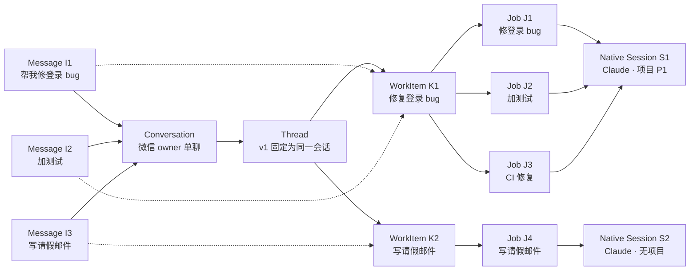
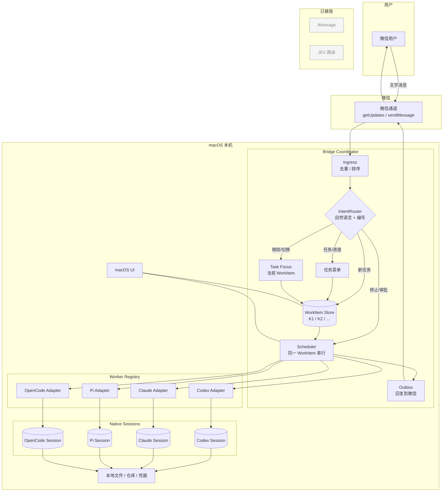
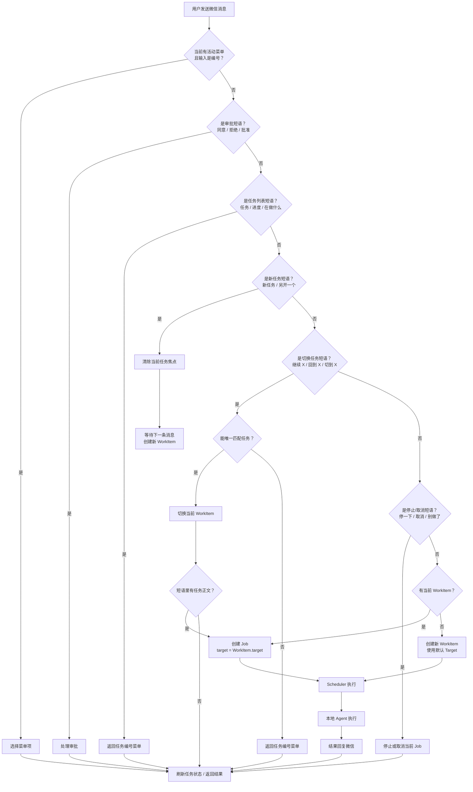

# 微信单通道 Super Agent 改造方案

日期：2026-11-10。状态：微信单通道 v1 已实现（2026-11-16）。

关联：

- [Super-agent 风格的路由与对话改造设计](super-agent-routing-design.md)
- [微信单通道 Super Agent 图（Mermaid）](wechat-super-agent-diagrams.md)
- [智能路由首版计划](smart-routing-plan.md)
- [技术方案](technical-plan.md)

---

## 0. 结论

这次不追求“多通道 + 云端 + 模型路由”。只做一件事：

> **把微信单聊改造成“任务焦点”模型：一个微信 owner、一个会话流、多个 WorkItem，每个 WorkItem 绑定一个本地 Agent Session。**

具体决定：

- 保留微信，删除 iMessage。
- 删除 JEV，不再引入模型路由。
- 不引入 Telegram、云端 Session、Main Agent。
- v1 只新增 `WorkItem` 和任务焦点（Task Focus）。
- 现有的项目/会话菜单保留，但只在“新建任务”时使用。
- 用户用自然语言（“任务”“新任务”“继续登录 bug”）和编号切换任务；普通消息默认进入当前任务。
- 斜杠命令只作为高级别名，不要求手机用户学习。

一句话：

```text
微信消息 -> 当前任务 WorkItem -> Job -> 本地 Agent Session
```

Super Agent 的核心仍然成立：**任务有独立上下文，Worker 有独立 Session，切换任务不会污染正在执行的任务。**

### 0.1 比上一版简单在哪

| 维度 | 上一版（多通道 + Planner） | 这一版（微信单通道） |
| --- | --- | --- |
| 通道 | iMessage / 微信 / Telegram | 微信 |
| 新增实体 | Conversation、Thread、WorkItem、Ingress | 只有 WorkItem |
| 路由 | WorkItem 选择 + 目标选择 + JEV | 任务焦点 + 菜单 |
| 模型依赖 | JEV | 无 |
| 云端 | 可选云控制面 | 无 |
| 失败面 | 多通道 + 多端同步 | 单机、单通道 |

### 0.2 设计图

完整图源：[微信单通道 Super Agent 图](wechat-super-agent-diagrams.md)。

#### 1. 核心模型



#### 2. 系统架构



#### 3. 用户使用流程



### 0.3 实现状态（2026-11-16）

- 已新增 `WorkItem`、任务焦点、任务编号菜单。
- 已新增 `IntentRouter`：自然语言“任务/进度/新任务/继续 X/停一下/同意/拒绝”，斜杠命令只作为别名。
- 已删除 JEV：`routing.ts`、路由设置、API Key、JEV onboarding 和路由 RPC 均移除。
- 已删除 iMessage：适配器、权限、配对、设置、依赖和测试均移除。
- 已保留微信单通道和桌面端。
- 验证：`bridge` 230 项测试通过；macOS `swift test` 68 项通过（3 项跳过）。

---


## 1. 范围

### 1.1 做

- 微信单聊文字消息。
- 一个 owner、一个微信会话。
- 多个 WorkItem（任务）并存。
- 每个 WorkItem 一个原生 Agent Session。
- 每个 WorkItem 可以有多轮 Job。
- 任务焦点：普通消息进入当前任务。
- 说“任务/进度”列出任务，回复编号切换。
- 说“新任务/另开一个”开始新任务。
- 现有 `/agent`、`/project`、`/sessions`、`/status`、`/stop`、`/cancel`、`/approve` 保留。
- 删除 iMessage 和 JEV 相关代码、设置、权限和 onboarding。

### 1.2 不做

- 不做微信群聊。
- 不做图片/语音/文件输入。
- 不做多 owner、多账号。
- 不做 Telegram、iMessage、云端控制面。
- 不做自然语言任务切换。
- 不做跨 Agent 上下文交接。
- 不做自动任务拆分或多 Agent 协作。

### 1.3 为什么可以不做 Conversation/Thread

微信当前适配只有一个 owner 单聊，所以：

```text
Conversation = 微信 owner
Thread       = 同一个会话
```

v1 不需要建 `Conversation`、`Thread` 两张表，也不需要处理群话题、reply root、外部 PR 线程。把它们留到以后。

---

## 2. 核心模型

```text
微信 owner
  │
  ▼
Conversation（固定一个）
  │
  ▼
WorkItem K1  「修复登录 bug」
  ├── Job J1  「帮我修登录 bug」  → Native Session S1
  ├── Job J2  「加个测试」        → Native Session S1
  └── Job J3  「CI 挂了，修一下」 → Native Session S1

WorkItem K2  「写请假邮件」
  └── Job J4  「写封请假邮件」    → Native Session S2
```

层次：

| 层 | 在微信单通道里是什么 |
| --- | --- |
| Message | 一条微信消息 |
| Conversation | 当前绑定的 owner 单聊 |
| Thread | 不需要单独建模，等同于 Conversation |
| WorkItem | 一件任务 |
| Job | 任务的一轮执行 |
| Native Session | Codex/Claude/Pi/OpenCode 的原生会话 |

关键规则：

1. **普通消息默认进入当前 WorkItem。**
2. **说“新任务”清除当前任务焦点，下一条消息创建新 WorkItem。**
3. **说“任务/进度”列出任务，回复编号切换当前任务。**
4. **WorkItem 创建时冻结 Target。**
5. **切换任务不改变正在运行的 Job 的目标。**
6. **回复永远发回微信 owner，不看当前焦点。**

---

## 3. 用户怎么用

交互原则：

> **用户不需要记斜杠命令。**  
> 自然语言、编号、当前任务焦点是主路径；`/...` 只作为高级别名和调试入口。

### 3.1 第一次使用

```text
用户：帮我修登录 bug

Bot：已开始「修复登录 bug」
     目标：Claude Code · 项目 P1 · 新会话
     继续这个任务直接发消息即可。
```

不需要先选项目/会话，也不需要输入 `/new`。

### 3.2 继续当前任务

```text
用户：加个测试

Bot：好的，已继续「修复登录 bug」。
```

普通消息默认进入当前任务。

### 3.3 查看任务

用户说：

```text
任务
看看任务
现在有哪些任务
进度
```

Bot：

```text
现在有 2 个任务：
1. 修复登录 bug（进行中，当前）
2. 写请假邮件（等待你确认）

回复 1 或 2 切换；回复“新任务”开始新的。
```

这里的 `1`、`2` 不是斜杠命令，就是普通数字回复。

### 3.4 切换任务

三种自然方式：

**方式一：回复编号**

```text
用户：2
Bot：已切换到「写请假邮件」。
```

**方式二：直接说任务名**

```text
用户：继续登录 bug
Bot：已切换到「修复登录 bug」。
```

规则：

- 在任务标题里做匹配，唯一命中就切换；
- 多个任务都匹配，发编号菜单让用户选；
- 匹配不到，问“要继续当前任务，还是新建？”。

**方式三：引用/回复某条任务消息**

微信支持引用消息时，可以后续接入：用户引用 Bot 的任务卡回复，就直接进入那个任务。v1 先不做，先把编号和任务名匹配跑稳。

### 3.5 新建任务

```text
用户：新任务
Bot：好，下一条消息创建新任务。
     当前默认目标：Claude Code · 项目 P1
     直接发消息即可；想换目标可以说“换成 Claude”或“换项目”。
```

也支持：

```text
新任务：帮我写封请假邮件
另开一个，查一下 CI
单独做一件事：整理发布说明
```

Bot 会从这句话里去掉“新任务”前缀，把剩余内容作为新任务。

### 3.6 修改新任务的目标

用户可以直接说：

```text
换成 Claude
用 Cursor
换个项目
看看有哪些会话
```

Bot 返回编号菜单或确认信息。例如：

```text
Bot：
当前 Agent 可用的项目：
1. chat-bridge
2. 商城
3. 无项目
回复编号选择；这只会影响下一条新任务。
```

这些操作不改变已有 WorkItem 的 Target。

### 3.7 查看进度

```text
用户：进度
现在怎么样
在做什么
```

Bot：

```text
当前任务：修复登录 bug（运行中）
目标：Claude Code · 项目 P1 · 会话 S1

正在执行：
J1 修登录 bug

其他任务：
2. 写请假邮件（等待你确认）
```

### 3.8 停止、取消、审批

自然语言：

```text
停一下
取消这个
别做了
同意
拒绝
批准
```

规则：

- 有且只有一个 pending 审批时，“同意/拒绝”才作为审批；
- “可以”这种常见词不作为审批，避免误判；
- “停/取消”只在当前任务有运行中 Job 时生效；
- 多个任务都可能匹配时，先让用户选编号。

### 3.9 斜杠命令只作为别名

保留但不宣传：

| 自然语言 | 高级别名 |
| --- | --- |
| 任务 / 看看任务 | `/tasks` |
| 新任务 | `/new` |
| 进度 | `/status` |
| 换成 Claude | `/agent claude` |
| 换个项目 | `/project` |
| 看看会话 | `/sessions` |
| 停一下 | `/stop J1` |
| 取消 | `/cancel J1` |
| 同意 / 拒绝 | `/approve A123`、`/deny A123` |

斜杠命令给桌面端、键盘用户和排障使用；手机用户不需要学。

### 3.10 Bot 怎么教用户

不要发命令教程。用每次任务的状态消息教会用户：

```text
已开始「修复登录 bug」。
继续这个任务直接发消息；想看其他任务，回复“任务”。
```

任务完成时：

```text
「修复登录 bug」已完成。
继续这个任务直接发消息；开始新的，回复“新任务”。
```

只在需要时出现，不每条消息都重复。

---

## 4. 消息流程

```text
微信 getUpdates
      │
      ▼
Ingress
  ├── message_id 去重
  ├── 只接受 owner 单聊文字
  └── 写入 inbox
      │
      ▼
IntentRouter（确定性）
  ├── 当前菜单编号？        -> 选择菜单项
  ├── 审批短语？            -> 同意/拒绝
  ├── 任务列表短语？        -> 发任务菜单
  ├── 新任务短语？          -> 进入新任务
  ├── 切换任务短语？        -> 匹配并切换
  ├── 控制短语？            -> 停止/取消
  └── 其他                  -> 普通任务消息
      │
      ▼
当前 WorkItem 存在？
  ├── 是 -> 创建 Job(workItemId=当前任务, target=任务 Target)
  └── 否 -> 创建 WorkItem + Job（使用默认 Target）
      │
      ▼
Scheduler
  ├── 同一 WorkItem 串行
  ├── 同一 Agent 按现有 agentTails 串行
  └── 运行 Job
      │
      ▼
Outbox -> 微信 owner
```

### 4.1 路由优先级

```text
1. 活动菜单中的数字
2. pending 审批的“同意/拒绝”
3. 任务列表短语（任务、进度、在做什么）
4. 新任务短语（新任务、另开一个、单独做）
5. 切换任务短语（继续 X、回到 X、切到 X）
6. 控制短语（停、取消、别做了）
7. 其他普通消息 -> 当前任务
8. 没有当前任务 -> 创建新任务
```

### 4.2 意图规则

| 意图 | 触发例子 | 行为 |
| --- | --- | --- |
| 查看任务 | 任务、看看任务、有哪些任务、进度、在做什么 | 发任务编号菜单 |
| 切换任务 | 继续登录 bug、回到写请假邮件、切到 K2 | 唯一匹配则切换；多个则菜单 |
| 新建任务 | 新任务、另开一个、单独做、重新开始 | 清空焦点，下一条创建新任务 |
| 新建并带内容 | 新任务：写封请假邮件 | 去掉前缀，直接创建新任务 |
| 修改目标 | 换成 Claude、用 Cursor、换个项目 | 修改下一条新任务的默认目标 |
| 停止 | 停一下、别做了、停止 | 停止当前任务运行中的 Job |
| 取消 | 取消这个、算了 | 取消当前任务未发送的 Job |
| 审批 | 同意、拒绝、批准 | 仅在有 pending 审批时生效 |

### 4.3 不确定时怎么办

不要猜。发一个两三个选项的编号问题：

```text
这条消息是继续「修复登录 bug」，还是新任务？
1. 继续「修复登录 bug」
2. 新建任务
```

或者：

```text
有两个任务都可能匹配：
1. 修复登录 bug
2. 修复支付错误
回复编号选择。
```

### 4.4 默认进入当前任务，但有两个例外

普通消息默认进入当前任务，因为这是最常见的续聊。

例外：

- **当前任务已结束**，且用户发来一条不像续聊的消息：先问“继续已完成的任务，还是新任务？”
- **当前任务闲置超过 30 分钟**：同样先问一次，避免把新话题接进旧任务。

不满足例外时，直接进入当前任务，不打断用户。

### 4.5 v1 的已知限制

- 用户在 K1 进行中直接说“写封请假邮件”，如果没有说“新任务”，它会进入 K1。
- 这是 v1 用可预测性换掉模型路由的代价。
- 通过任务完成提示和“新任务”短语，让用户自然学会切换。
- 后续可以在 `IntentRouter` 后面加一个可选模型 Planner，但不恢复 JEV 依赖。

### 4.6 引用回复（后续）

微信消息有 `ref_msg`，可以拿到被引用消息。后续可以：

- Bot 的每条任务卡记录 `message_id -> workItemId`；
- 用户引用任务卡回复，就直接进入该 WorkItem；
- 这是最自然的“切换任务”方式，但需要先验证发送消息 ID 的可得性。

v1 不依赖它。

## 5. 数据模型

v1 只新增一个实体：`WorkItem`。不建 Conversation/Thread 表。

```ts
type WorkItem = {
  id: string;                 // "K" + 12 hex
  title: string;              // 首条消息截断到 40–60 字
  status: "open" | "running" | "waiting" | "blocked" | "done" | "cancelled";
  target: Target;             // 创建时冻结；创建会话后补 sessionId
  sessionId?: string;
  jobIds: string[];
  createdAt: string;
  updatedAt: string;
  closedAt?: string;
  lastJobId?: string;
};
```

`Job` 增量字段：

```ts
type Job = {
  // ...现有字段
  workItemId?: string;
};
```

`Message` 增量字段：

```ts
type Message = {
  // ...现有字段
  workItemId?: string;
};
```

焦点：

```ts
// kv["task-focus"]
type TaskFocus = {
  workItemId: string | null;
  version: number;
};
```

存储：

- `records(kind="work-item", id=K...)`
- `records(kind="job", id=J...)` 增加 `workItemId`
- `records(kind="message", id=...)` 增加 `workItemId`（可选）
- `kv["task-focus"]`
- `kv["selection"]` 继续作为“下一条新任务”的默认目标

不需要 `receivedSeq`：微信单通道、单 owner，现有 `records` 的 rowid 顺序 + `inbox` 去重足够。等以后多通道/群聊再加。

### 5.1 数据迁移

不需要改 SQL 表结构，也不需要提升 `user_version`：`records` 是 JSON，新增 kind 和可选字段即可。启动时做一次惰性迁移：

- 旧 `Job` 没有 `workItemId`：为每个已接受的 Job 创建一个 WorkItem，`Job.workItemId` 指向它；标题取 Job 文本前 40–60 字。
- 旧 `routing` / `awaiting_route` Job：不要静默发送。转为 `awaiting_confirmation`，提示用户重新发送或选择目标；或在升级时直接取消并保留原文。
- 旧 `Message` 没有 `workItemId`：按同一 Session 内的 Job prompt 匹配；匹配不到就留空，只用于历史展示。
- `task-focus` 不存在：默认取最近一个未结束 WorkItem；没有则空。
- 旧 JEV 设置和 Key：升级时删除 `routing` kv 和 Keychain 条目，避免残留。

v1 默认 **一个 WorkItem 一个 Native Session**。不推荐多个 WorkItem 共享 Session；共享会让原生历史无法精确归属到任务。

---

## 6. 状态机

### 6.1 WorkItem

```text
创建 -> open
       │
       ├── 有 Job running -> running
       ├── 有审批/问题    -> waiting
       ├── Job failed     -> blocked
       ├── 所有 Job 完成  -> done
       └── 用户取消       -> cancelled
```

规则：

- `done` 的 WorkItem 仍可被后续消息恢复（新建 Job，复用原 Session）。
- 要开始新任务，说“新任务”。
- `cancelled` 不再接收消息。
- WorkItem 结束不删除 Session；原生会话仍可由“任务”菜单恢复。

### 6.2 Job

沿用现有状态：

```text
accepted -> preparing -> dispatching -> queued -> running
        -> awaiting_approval -> stopping
        -> completed / failed / interrupted / uncertain / cancelled
```

删除 `routing` / `awaiting_route` 两个状态，因为 v1 没有模型路由和异步目标选择。

---

## 7. 并发、幂等与恢复

### 7.1 并发

```text
同一 WorkItem：同时最多一个 active Job
同一 Agent：沿用 agentTails 串行
不同 WorkItem：可以排队，适配器允许时可并行
```

- 用户切到 K2 时，K1 的 running Job 继续跑，不改目标。
- K1 完成时回执仍发微信 owner。
- 不承诺多个 Agent 同时执行；当前 GUI 适配器可能仍全局串行。

### 7.2 幂等

- `inbox` 继续以 `weixin + account + owner + message_id` 去重。
- 创建 WorkItem 时以首条消息的 `job.id` 作为幂等依据；重复处理返回同一个 K。
- `creationKey` 绑定到 WorkItem，重启后复用，避免创建第二个 Session。
- Outbox 继续使用现有去重和“不确定不自动重发”。

### 7.3 恢复

| 崩溃点 | 恢复 |
| --- | --- |
| 收到消息、未写 inbox | 游标未提交，重新读取 |
| 写了 inbox、未建 WorkItem | 重新处理该 Job，幂等创建 |
| WorkItem 已建、Session 未建 | 复用 creationKey |
| Session 已建、Job 未派发 | 继续 accepted |
| Job 已派发、结果未知 | `uncertain`，要求用户核对，不自动重发 |
| 回复未发出 | 现有 Outbox 重试 |

启动时：

1. 载入 `task-focus`；
2. 若焦点指向不存在/已取消的任务，清空；
3. 恢复未完成 Job；
4. 不重建 Session。

---

## 8. 代码改造清单

### 8.1 核心

| 文件 | 改动 |
| --- | --- |
| `bridge/src/core.ts` | 新增 WorkItem 类型、`work-item` 记录、`task-focus`、任务菜单；`receive` 普通消息直接创建/追加 WorkItem；新增 IntentRouter（任务/新任务/切换/进度/停止/审批）；删除 `routeJob`/`routingContext`/`applyRoute` 的模型路由路径；`state()` 返回 workItems 和 focus |
| `bridge/src/routing.ts` | 删除 `JevGateway`、`routingProviders`、路由设置与置信度逻辑；保留必要的 `Target` 类型或迁移到 `core.ts` |
| `bridge/src/routing-options.ts` | 保留文本菜单渲染；增加 task 菜单 |
| `bridge/src/intent.ts` | 新增 IntentRouter：数字菜单、任务列表、新任务、切换、进度、停止、审批；只匹配短句/前缀，避免把普通任务正文当命令 |
| `bridge/src/commands.ts` | `parseInput` 先识别自然语言意图，再识别斜杠别名；斜杠命令继续可用 |
| `bridge/src/service.ts` | 删除 JevGateway 注入、路由设置 RPC、API Key 管理；保留命令/状态 RPC |
| `bridge/src/weixin.ts` | 基本不改；继续只接受 owner 单聊文字；`ref_msg` 留作以后引用回复 |
| `bridge/src/channels.ts` | 删除 iMessage controller 引用 |
| `bridge/src/imessage.ts` / `imessage-source.ts` | 删除 |
| `bridge/src/messages.ts` | 可增加任务标题/状态文案 |

### 8.2 macOS

| 文件 | 改动 |
| --- | --- |
| `apps/macos/.../SettingsView.swift` | 删除 JEV 路由设置、iMessage 配置；保留微信和 Agent 设置 |
| `apps/macos/.../Onboarding*` | 删除 iMessage 配对、JEV 介绍；改为微信单通道说明 |
| `apps/macos/.../BridgeService.swift` | 删除 iMessage/JEV 相关 RPC 字段 |
| `apps/macos/.../ChatView.swift` | 增加任务列表/任务状态展示；会话列表仍保留 |
| `Apps/macos/.../Info.plist` / entitlements | 删除 Full Disk Access、Automation 相关说明（若仅 iMessage 使用） |

### 8.3 测试与文档

- 删除 `bridge/test/smart-routing.test.ts`、`routing-*.test.ts` 中 JEV 相关用例；
- 保留并改造菜单/命令/任务测试；
- 新增 `work-item` 生命周期、任务焦点、IntentRouter、重启恢复、重复消息测试；
- 更新 `docs/technical-plan.md`、`docs/implementation-status.md`、`README`；
- `docs/smart-routing-plan.md` 标记为历史/被替代。

---

## 9. 实施顺序

### 阶段 0：先冻结范围

- 确认只支持微信单聊文字。
- 确认删除 iMessage、JEV、Telegram、云端。
- 确认 v1 任务切换是自然语言（“任务/新任务/继续 X”）+ 编号，不做模型路由。

### 阶段 1：WorkItem + 任务焦点（不删任何东西）

- 新增 WorkItem 类型和存储。
- 普通消息创建/追加 WorkItem。
- 自然语言“任务/新任务”、任务菜单、编号切换。
- `Job.workItemId`、`Message.workItemId`。
- 现有 JEV 仍然存在，但默认关闭；先用任务焦点路径验证。
- 验收：连续对话、切换任务、重启恢复。

### 阶段 2：删除 JEV

- 删除路由设置、API Key、JEV Gateway、置信度/动作选择。
- 删除 `routing`/`awaiting_route` 状态。
- 迁移旧 `routing`/`awaiting_route` Job，不静默发送。
- 删除 onboarding 中的 JEV。
- 把测试改为确定性路由测试。
- 验收：无 JEV 时所有既有命令、菜单、任务都正常。

### 阶段 3：删除 iMessage

- 删除 iMessage 适配器、TCC 权限、配对流程、设置项、测试。
- 删除 `channels.ts` 中的 iMessage controller。
- 验收：微信配对/重连/收发/审批全部通过；应用不再申请 Full Disk Access。

### 阶段 4：清理与观察

- 更新文档和截图。
- 观察真实使用中的任务切换频率；如果“普通消息进入当前任务”不够用，再考虑可选的 Planner，而不是恢复 JEV。

---

## 10. 验收用例

| 场景 | 预期 |
| --- | --- |
| 第一条消息 | 创建 K1 + J1 + S1 |
| 第二条消息 | 进入 K1 + J2 + S1 |
| 说“任务” | 显示 K1，编号 01 |
| 说“新任务”后发消息 | 创建 K2 + J3 + S2 |
| 说“任务”选 01 | 焦点回到 K1；K2 保持原状 |
| K1 running 时切到 K2 | K1 继续跑，目标不变 |
| K1 完成 | 回执发微信 owner，不落到 K2 |
| 重复投递同一 message_id | 只创建一条 Inbox/Job |
| 重启后说“任务” | K1/K2 和焦点恢复 |
| 原生 Session 被删除 | WorkItem blocked，不自动换 Session |
| 说“停一下” | 只停 K1 的 J1，不影响 K2 |
| 说“进度” | 显示当前任务和其他任务 |
| 没有 JEV Key | 全部功能正常 |

---

## 11. 风险与取舍

| 风险 | 说明 | 处理 |
| --- | --- | --- |
| 普通消息进错任务 | 用户在 K1 中直接说“写请假邮件”会进入 K1 | v1 用“新任务”显式新建；后续可选 Planner |
| 微信个人号不稳定 | 依赖本机登录和协议 | 保留 Channel 接口，未来可加 Telegram |
| 单通道单点故障 | 微信掉线就不可用 | 状态页明确提示；重连/游标保留 |
| 没有自然语言路由 | 不如 JEV “聪明” | 用任务焦点降低歧义；先稳定再考虑模型 |
| 删除 iMessage 影响 Apple 用户 | 产品范围变化 | 作为独立决策记录；代码可从历史恢复 |
| 会话共享 | 新任务可能复用旧 Session | “新任务”默认新 Session；显式选择才复用 |

---

## 12. 未来扩展

不改变 v1 模型的前提下，可以按顺序加：

1. **可选 Planner**：`FocusPlanner`（v1）、`MenuPlanner`、`ModelPlanner`（Pi/Claude/小模型），接口统一。
2. **引用回复**：微信 `ref_msg` 可用时，把引用消息映射到它的 WorkItem。
3. **群聊**：增加 `conversationId` / `actorId`，再引入 Thread。
4. **Telegram**：实现同一个 Channel 接口，利用 Forum Topic 做真正的 Thread。
5. **云控制面**：只同步 WorkItem 和队列，执行仍在本地。

但在 v1，这些都不做。

---

## 13. 一句话

> **微信单通道 v1 不需要 Conversation/Thread/云端/模型路由；只需要 WorkItem + 任务焦点。先把“每件任务有自己的 Session、切换任务不串上下文”做稳，再谈更复杂的 Super Agent。**

---

## 14. 软件更新

- 设置页“软件更新”和菜单栏“检查更新…”都可手动检查。
- 启动后 5 秒检查一次，之后每小时自动检查一次 GitHub Releases。
- 只接受高于当前版本的稳定发布，按当前架构选择 `ChatBridge-<version>-macos-arm64.dmg` 或 `macos-x86_64.dmg`。
- 下载后校验 `SHA256SUMS.txt`、应用 Bundle ID、版本号和代码签名。
- 安装时退出应用，由临时脚本替换当前 `.app` 并重新打开；失败时保留旧版本和应用包，不静默删除。
- 当前安装位置只读或处于 App Translocation 时，提示用户移到“应用程序”后重试。
